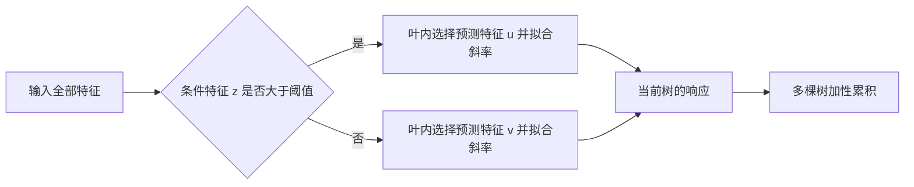

# CrossGB 实验研究汇报：论文已有数据与本轮新增数据

**整理/分组核验：2026-10-31｜内部讨论稿｜pool 原实验专版**  
**本轮结果截止：2026-10-30 07:41（北京时间）**。本稿按“数据任务/生成式是否已在投稿正文或附录出现”分为两部分。结果均来自本轮 pool 审核快照；新跑的结果与论文原始数值分别记账。本次分组整理未新增训练。

**写作口径：已有数据集上的新结果，称“补充近邻对照实验”；论文未列入的公开任务，称“新增公开数据集”；重新定义生成式所得场景，称“新构造机制面板”。数据早已存放在代码仓库中，并不等于它已进入论文正文/附录。**

| 写作部分 | 本轮公开任务范围 | 完整五方法三次确认 | 本轮合成范围 |
|---|---:|---:|---|
| 第一部分：论文已有数据 | 18个：正文及附录8个、附录列出10个 | 14个，CGB为3个第一/7个第二/4个第三 | 原论文19个生成器作背景；未在本轮重跑原生成式 |
| 第二部分：本轮新增数据 | 6个已准备，其中5个执行、Yacht Hydrodynamics未执行 | 5个，CGB为2个第一/2个第二/1个第三 | 新构造6组×8变体=48场景，24第一/22第二/2第三 |

数据集展示名沿用投稿中的英文名；新增任务使用英文任务名。数据描述表同时列出原始数据集标识，以对应CSV文件，任务说明仍使用中文。共同的方法介绍、超参数空间和切分协议在附录A/B；准确性表在对应部分，成本及讨论在附录C/D。**“新结果”与“新数据集”是两个不同维度。** 原论文还包含其他回归/分类/时序任务；本稿对照清单覆盖本轮回归搜索池，不冒充论文全部数据目录。

## 第一部分：论文正文/附录已有的数据与本轮补充实验

### I.1 公开基准：身份、论文出处与本轮状态

依据投稿正文 Table 3（PDF第7页）及技术附录 E.1、Table 14（PDF第12页）逐项核对。下列18个任务均已在论文报告过；其本轮五方法比较属于新增实验，而非新增数据集。Used Fiat 500、Concrete compressive strength、Diamonds、Wine quality等不能因为本轮出现优势，就重新归类为“新找的数据”。

| Dataset | 原始数据集标识 | n | d原始→编码 | 任务/归档目标 | 论文位置 | 本轮状态 |
|---|---|---:|---:|---|---|---|
| Used Fiat 500 | `Another-Dataset-on-used-Fiat-500` | 1,538 | 7→9 | 车型、动力、车龄、里程等 → price | 附录T14 | 完整确认 |
| Food delivery time | `Food_Delivery_Time` | 45,451 | 8→14 | 配送员、餐厅/目的地位置、订单类型等 → Time_taken(min) | 附录T14 | 确认不完整 |
| QSAR fish toxicity | `QSAR_fish_toxicity` | 907 | 6→6 | 6 个分子描述符 → LC50 | 正文T3 + 附录T14 | 完整确认 |
| Airfoil self noise | `airfoil_self_noise` | 1,503 | 5→5 | 频率、攻角、弦长、流速等 → scaled-sound-pressure | 附录T14 | 完整确认 |
| Concrete compressive strength | `concrete_compressive_strength` | 1,030 | 8→8 | 配比与龄期 → ConcreteCompressiveStrength | 附录T14 | 完整确认 |
| Diamonds | `diamonds` | 53,940 | 9→26 | 重量、等级和尺寸 → price | 附录T14 | 完整确认 |
| Healthcare insurance expenses | `healthcare_insurance_expenses` | 1,338 | 6→11 | 年龄、BMI、吸烟等 → charges | 附录T14 | 完整确认 |
| Houses | `houses` | 20,640 | 8→8 | 收入、房龄、房间数、经纬度等 → LnMedianHouseValue（已取对数） | 附录T14 | 完整确认 |
| Miami housing | `miami_housing` | 13,776 | 15→15 | 位置、面积、区位距离等 → SALE_PRC | 附录T14 | 完整确认 |
| Physiochemical protein | `physiochemical_protein` | 45,730 | 9→9 | 表面积、暴露度、结构惩罚等 → 归档目标 ResidualSize | 附录T14 | 完整确认 |
| Wine quality | `wine_quality` | 6,497 | 12→13 | 理化特征与类别 → 归档目标 median_wine_quality | 附录T14 | 完整确认 |
| Moneyball | `Moneyball` | 114 | 14→40 | 球队、赛季和比赛统计 → RS | 正文T3 + 附录T14 | HPO后未确认 |
| Abalone | `abalone` | 4,177 | 8→10 | 性别、尺寸、重量等 → 归档目标 target | 正文T3 + 附录T14 | HPO后未确认 |
| CPU activity | `cpu_activity` | 8,192 | 21→— | 系统活动计数 → usr | 正文T3 + 附录T14 | 预筛后未确认 |
| Energy efficiency | `energy_efficiency` | 768 | 8→8 | 8 个建筑几何/玻璃参数 → Y1（heating load） | 正文T3 + 附录T14 | 完整确认 |
| Kin8nm | `kin8nm` | 8,192 | 8→8 | 8 个关节角 → y（末端距离） | 正文T3 + 附录T14 | 完整确认 |
| Naval propulsion plant | `naval_propulsion_plant` | 11,934 | 14→14 | 运行与传感特征 → 压缩机退化系数 | 正文T3 + 附录T14 | 完整确认 |
| Space GA | `space_ga` | 3,107 | 6→6 | 人口、教育、住房、收入、坐标 → ln(VOTES/POP) | 正文T3 + 附录T14 | 完整确认 |

其中14个完成确认；Food delivery time仅14/15次成功最终拟合，Moneyball、Abalone、CPU Activity没有完整确认。原论文正文另有Boston、Friedman1，本轮未纳入，未把它们记成新数据或漏失结果。仿真身份与新旧来源是独立分类：Energy efficiency、Kin8nm、Naval propulsion plant都属于论文已有任务，也都单列为公开仿真。

### I.2 原论文合成面板：作为已有机制与历史结果背景

正文§4.2/Table 1（PDF第5页）及附录C.1/Table 6（PDF第5页）包含19个生成器；附录还报告10/20维结果。生成器为：**Global linear；Regime slope；Feature switch；Multiplicative；XOR classification；Regime logit；Three-way XOR；Conditional multiplicative；Multi-regime slope；Categorical regime slope；Categorical feature switch；Mixed-gate regime；Sparse multiplicative；Sparse regime slope；Sparse feature switch；Noisy regime slope；Pure-step control；Curved；Additive nonlinear**。

原面板采用n=3000、data seed=42，连续信号变量主要为均匀分布，追加高斯无关变量至10或20维；普通回归噪声SD为0.15，Noisy regime slope为0.75。主要评价为5外折×4内折、每模型300候选。它包含正机制与负控制，且有分类任务；与本轮48个回归场景不是同一批数据。

原论文自身已在若干斜率、交互场景出现正结果。此前讨论中“近邻最优不足”的直接依据主要是随后N1补充比较的三个旧场景，不能扩大成“原论文19个合成机制全部劣势”。N1、N2、N5是投稿后的补充实验编号，本稿也不会仅因它们早于本轮就说其已包含在投稿正文/附录。

### I.3 已有数据上的本轮补充近邻结果

以下全部是本轮pool的数值，不是原论文表格原值。按五方法平均RMSE排序；Δ=100×(CGB/最佳对手−1)，负值表示优于最佳对手。HPO成功数顺序为 **CGB/LinX/PILOT/PL/TAO**，计划均为24配置。原始目标单位跨任务不同，不直接平均RMSE。

| 基准 | CrossGB | PL | LinX | PILOT | TAO | 排名 | Δ最佳对手 | HPO成功数 |
|---|---:|---:|---:|---:|---:|---:|---:|---|
| Used Fiat 500 | 811 | 817.56 | 812.58 | 827.36 | 915.8 | 1 | -0.19% | 24/24/24/24/24 |
| QSAR fish toxicity | 0.87948 | 0.87743 | 3.5053 | 0.91516 | 0.95098 | 2 | +0.23% | 24/24/24/24/24 |
| Airfoil self noise | 1.7694 | 1.6547 | 1.831 | 4.3641 | 3.7339 | 2 | +6.93% | 24/24/24/24/24 |
| Concrete compressive strength | 5.104 | 5.3205 | 5.1642 | 6.651 | 7.7415 | 1 | -1.17% | 24/24/24/24/24 |
| Diamonds | 561 | 745.74 | 682.08 | 629.93 | 695.18 | 1 | -10.94% | 24/15/24/24/24 |
| Healthcare insurance expenses | 4531.7 | 4657.4 | 4446.3 | 4492.9 | 5286.5 | 3 | +1.92% | 24/24/24/24/24 |
| Houses | 0.22985 | 0.22549 | 0.26374 | 0.26057 | 0.30359 | 2 | +1.93% | 24/13/24/24/24 |
| Miami housing | 93941 | 90056 | 1.1088e+05 | 1.1683e+05 | 1.3537e+05 | 2 | +4.31% | 24/7/24/24/24 |
| Physiochemical protein | 3.872 | 3.7237 | 5.2553 | 4.5948 | 4.798 | 2 | +3.98% | 24/4/24/24/24 |
| Space GA | 0.11828 | 0.1056 | 0.10072 | 0.13036 | 0.12743 | 3 | +17.43% | 24/22/24/24/24 |
| Wine quality | 0.6397 | 0.63304 | 0.6626 | 0.71428 | 0.72634 | 2 | +1.05% | 24/24/24/24/24 |
| Energy efficiency | 0.60028 | 0.50922 | 0.47503 | 1.7551 | 1.3047 | 3 | +26.37% | 24/24/24/24/24 |
| Kin8nm | 0.10419 | 0.10206 | 0.14131 | 0.17956 | 0.13606 | 2 | +2.09% | 24/15/24/24/23 |
| Naval propulsion plant | 0.0012929 | 0.0012867 | 0.00045743 | 0.0033425 | 0.0028055 | 3 | +182.65% | 24/11/24/24/24 |

Used Fiat 500、Concrete compressive strength、Diamonds是已有数据上的本轮第一；Used Fiat 500领先仅0.19%，Diamonds的LinX仅15/24成功。Kin8nm距最优约2.09%；Energy efficiency、Naval propulsion plant虽第三但差距较大，不作为接近最优案例。原论文与本轮的对照方法、预处理、样本划分、搜索预算均不同，所以这些数值不能拼接成同协议前后提升，也不能替换原表而不解释协议。

## 第二部分：本轮新找的公开数据与新构造的合成数据

### II.1 新增公开任务：描述与状态

按归档核对的投稿正文和附录结果/生成式清单，下面6个任务未列入。QSAR-TID-11与Superconductivity此前已在本地归档候选池，但未出现在投稿结果表；它们属于本轮新增评价任务，不表示新发布的数据源。Real Estate Valuation、Combined Cycle Power Plant、Auto MPG为本轮下载追加，Yacht Hydrodynamics仅准备未执行。

| Dataset | 原始数据集标识 | n | d原始→编码 | 任务/归档目标 | 论文位置 | 本轮状态 |
|---|---|---:|---:|---|---|---|
| QSAR-TID-11 | `QSAR-TID-11` | 5,742 | 1024→1024 | 1024 位 FCFP6 分子指纹 → MEDIAN_PXC50 | 新增 | 完整确认 |
| Superconductivity | `superconductivity` | 21,263 | 81→81 | 81 个材料组成统计特征 → critical_temp | 新增 | 完整确认 |
| Real Estate Valuation | `uci477_real_estate_valuation` | 414 | 6→6 | 交易时间、屋龄、捷运距离、商店数、位置 → 单位面积房价 | 新增 | 完整确认 |
| Combined Cycle Power Plant | `uci294_combined_cycle_power_plant` | 9,568 | 4→4 | 温度、真空、气压、湿度 → PE（电功率） | 新增 | 完整确认 |
| Auto MPG | `uci9_auto_mpg` | 398 | 7→7 | 排量、气缸、马力、重量、加速、年份、产地 → mpg | 新增 | 完整确认 |
| Yacht Hydrodynamics | `uci243_yacht_hydrodynamics` | 308 | 6→— | 6 个船体/航行参数 → residuary_resistance | 新增 | 仅准备，未执行 |

### II.2 新增公开任务的准确性结果

| 基准 | CrossGB | PL | LinX | PILOT | TAO | 排名 | Δ最佳对手 | HPO成功数 |
|---|---:|---:|---:|---:|---:|---:|---:|---|
| QSAR-TID-11 | 0.99886 | 0.77902 | 1.0432 | 1.1464 | 1.0277 | 2 | +28.22% | 13/4/24/24/23 |
| Superconductivity | 9.6197 | 9.6871 | 17.567 | 12.67 | 14.39 | 1 | -0.70% | 24/4/24/24/21 |
| Combined Cycle Power Plant | 3.2882 | 3.2184 | 3.5204 | 4.022 | 4.3567 | 2 | +2.17% | 24/19/24/24/24 |
| Real Estate Valuation | 6.6059 | 6.4561 | 6.5008 | 7.3302 | 8.4788 | 3 | +2.32% | 24/24/24/24/23 |
| Auto MPG | 3.2813 | 3.3976 | 3.7426 | 3.4457 | 3.7323 | 1 | -3.42% | 24/24/24/24/24 |

**Auto MPG第一，距最佳对手低3.42%，五方法均24成功候选；Superconductivity第一，低0.70%，LinX仅4/24；Combined Cycle Power Plant第二，落后2.17%，LinX19/24；Real Estate Valuation第三，落后2.32%，TAO23/24；QSAR-TID-11第二，但落后28.22%，不能把前三等同为接近最优。** Yacht Hydrodynamics没有结果，不计入上述5例。

### II.3 新构造合成面板：相对原论文的继承与变化

本轮不是只把原论文生成器扩大样本数。它重新实现了生成式，同时更换基础信号分布、维度网格、部分噪声条件和评价协议。它继承了原论文的条件—预测交互思想；相关的生成器不能包装成完全无关的新机制。

| 本轮生成器 | 与原论文的关系 |
|---|---|
| gate_sum | 由原 Regime slope 扩展为多个门控模块之和 |
| switch4 | 由原 Feature switch 扩展为两个门控、四区变量选择 |
| stair_slope | 与原 Multi-regime slope / Sparse regime slope 同类；新系数与附加项 |
| saturating | 与原 Multiplicative 同属系数-预测交互；新增饱和系数函数 |
| correlated_gate | 新 gate_sum 的相关无关变量干预；不是独立核心信号机制 |
| hetero_gate | 新 gate_sum 的异方差干预；不同于原 Noisy regime slope 的同方差噪声加大 |

原面板10/20维、3000样本；新面板16/24/32/48维，预筛960/1920样本，HPO与每次确认2880/5760样本。输入由主要均匀信号改为高斯；从嵌套CV/300候选改为6配置预筛→24配置HPO→冻结参数→3个新生成seed确认。**机制、规模、分布和协议同时变化，目前不能单独归因“为何变好”，也不能宣称旧场景扩大后翻盘。** 新面板还未纳入原表中的XGB/LGB列，排名比较范围也不同。

所有生成器的基础变量为标准高斯。除相关干扰族外，输入独立；误差均值为 0。全部真实输入特征都向五个方法开放，不提供变量角色标签。

| 族 | 信号/噪声构造 | 要讨论的适配假说 |
|---|---|---|
| gate_sum | $y=\frac{2}{\sqrt m}\sum_{j=0}^{m-1}\mathrm{sgn}(x_j)x_{m+j}+\epsilon$ | 多个局部稀疏门控模块能否由简单树加性拼合 |
| switch4 | $r=2\mathbf{1}[x_0>0]+\mathbf{1}[x_1>0]$，$y=2s_r x_{2+r}+\epsilon$，$s=(-1,1,-1,1)$ | 两个门控变量决定四个区域中哪个预测坐标起作用 |
| stair_slope | $y=a(x_0)x_1+0.15x_2+\epsilon$，$a=-2,0.75,2.5$，阈值为 −0.5、0.5 | 分段斜率加一个小的额外线性项 |
| saturating | $y=1.5[\mathrm{clip}(x_0,-1,1)x_2+\mathrm{clip}(x_1,-1,1)x_3]+\epsilon$ | 连续变化且饱和的系数，可否用分段简单响应近似 |
| correlated_gate | gate_sum 信号不变；部分无关变量由两个独立干扰基变量的 $0.8U+0.6Z$ 构造 | 相关干扰变量群下的坐标选择；这里不是信号变量彼此共线，也不是干扰与信号相关 |
| hetero_gate | gate_sum 信号不变；噪声标准差为 $\sigma[2\mathbf{1}(x_0>0)+0.5\mathbf{1}(x_0\le0)]$ | 路由条件同时影响信号和噪声强度的情形 |

correlated_gate、hetero_gate 是对 gate_sum 的干扰结构与噪声干预。6 个族可以作为生成器分组；核心信号结构主要是门控加和、四区切换、阶梯斜率、饱和交互四类，不能将参数变体或两种干预宣传成完全独立的 48 个机制。

每族固定 8 个参数变体：

| 变体 | d | 预筛 n | HPO/每次确认 n | σ | m（适用门控加和族） |
|---|---:|---:|---:|---:|---:|
| v0 | 16 | 960 | 2880 | 0.15 | 2 |
| v1 | 24 | 960 | 2880 | 0.30 | 3 |
| v2 | 32 | 960 | 2880 | 0.15 | 4 |
| v3 | 48 | 960 | 2880 | 0.30 | 2 |
| v4 | 16 | 1920 | 5760 | 0.15 | 3 |
| v5 | 24 | 1920 | 5760 | 0.30 | 4 |
| v6 | 32 | 1920 | 5760 | 0.15 | 2 |
| v7 | 48 | 1920 | 5760 | 0.30 | 3 |

实际活跃变量数：gate_sum/相关干扰/异方差为 $2m$，switch4 为 6，stair_slope 为 3，saturating 为 4。旧元数据对所有族统一写 `d−2m` 干扰变量数，不适用于后三族；本稿以生成代码为准。该字段不参与拟合，不改变结果。

### II.4 新合成面板的准确性结果

| 生成器族 | 场景数 | 第一/第二/第三 | 平均RMSE低于PL | LinX成功HPO范围 |
|---|---:|---|---:|---|
| correlated_gate | 8 | 4/4/0 | 8/8 | 4–17/24 |
| gate_sum | 8 | 3/5/0 | 8/8 | 4–17/24 |
| hetero_gate | 8 | 5/3/0 | 8/8 | 4–18/24 |
| saturating | 8 | 8/0/0 | 8/8 | 4–17/24 |
| stair_slope | 8 | 2/4/2 | 6/8 | 4–17/24 |
| switch4 | 8 | 2/6/0 | 8/8 | 4–16/24 |

CrossGB 与 PL 在每个合成场景均 24 个成功 HPO 配置。LinX 各场景成功配置为 4–18/24，因此“46/48 优于 PL”具有较完整的双方法搜索覆盖，而“相对 LinX 的名次”必须同时披露不完整搜索。PILOT/TAO 的单树设置也限制了容量归因。

**饱和交互族 8/8 第一、8/8 优于 PL**，是本轮最集中的准确性证据。门控加和、相关干扰、异方差、四区切换均 8/8 优于 PL；阶梯斜率为 6/8，对 PL 也存在反例。48 个场景属于相关参数网格，不能当 48 个独立样本做总体显著性检验。

代表场景用于说明机制和工作点；它们是结果观察后的展示选择，不是新的独立检验：

| 场景 | CrossGB RMSE | PL RMSE | 相对PL降低 | LinX RMSE | CrossGB排名 | LinX HPO |
|---|---:|---:|---:|---:|---:|---|
| saturating_v4 | 0.18842 | 0.33244 | 43.32% | 0.23415 | 1 | 13/24 |
| switch4_v7 | 0.38001 | 0.46639 | 18.52% | 1.7513 | 1 | 4/24 |
| correlated_gate_v2 | 0.24898 | 0.85161 | 70.76% | 0.29068 | 1 | 11/24 |
| hetero_gate_v2 | 0.2833 | 0.78994 | 64.14% | 0.38135 | 1 | 11/24 |
| stair_slope_v4 | 0.18757 | 0.20987 | 10.62% | 0.15046 | 2 | 13/24 |

这张表支持的积极论点是：简单叶配合不同路由与加性结构，在若干明确生成机制上具有实用收益。它没有单独证明收益由角色分离、评分或标量叶中的哪一项导致；若要提出组件因果结论，还需在同协议下增加消融。

## 附录A：共同方法介绍与近邻方法

考虑响应规律：条件变量 $z$ 决定一个驱动变量 $u$ 的作用方向，$y=2u$（$z>0$）或 $y=-2u$（$z\le0$）。$z$ 用于路由，$u$ 用于预测；二者不必是同一个特征。理想的结构是在 $z$ 上分裂，再用叶内斜率描述 $u$，而不必把 $u$ 再切成很多常数台阶。

### A.1 本轮实际运行的叶模型

CrossGB 是梯度提升树框架中的受限线性叶模型。在区域 $R$ 内，一个叶选择一个预测坐标 $p_R$，输出 $w_Rx_{p_R}$；也允许选择值恒为 1 的 bias 伪特征，输出常数。**一个叶不是“截距 + 斜率”的一般仿射回归：它选择常数或一个过原点单变量响应。** 这里“过原点”是在经过本轮预处理后的坐标中；模型整体还包含基准项和多棵树之和。

$$
F_T(x)=F_0+\sum_{t=1}^{T}\eta_t\,f_t(x),\qquad
f_t(x)=w_{t,R_t(x)}\,\phi_{p_{t,R_t(x)}}(x),
$$

其中 $\phi_p(x)=x_p$，bias 候选为 $\phi_{bias}(x)=1$。不同叶可选择不同预测特征，多棵树可以分别表达不同模块。

### A.2 预测感知评分与标量求解

对某个区域和预测坐标 $p$，记梯度 $g_i$、Hessian $h_i$：

$$
G_p(R)=\sum_{i\in R}g_i\phi_p(x_i),\quad
H_p(R)=\sum_{i\in R}h_i\phi_p(x_i)^2,
$$
$$
w_p^*(R)=-\frac{G_p(R)}{H_p(R)+\lambda+\epsilon},\qquad
S_p(R)=\frac{G_p(R)^2}{H_p(R)+\lambda+\epsilon}.
$$

本轮 `score_agg=0` 对候选“条件特征—阈值—预测特征”组合计算 $S_p(L)+S_p(R)-S_p(P)$，选取最优评分；省略了不影响排序的统一常数因子。节点/叶的预测特征随后由 `BestLeaf` 选择。**分裂时同一预测坐标下的代理增益，不能直接等同为左右叶各自重新选变量后的精确全局目标下降。**

每个叶系数的求解只需标量统计量和一次除法，避免叶内多变量线性系统求解；但还要遍历条件特征、预测候选和阈值，不能由此推出整棵树训练必然更快，也不能据此保证所有数值问题消失。

本轮条件池与预测池是“职责可分”，不是已知标签下的互斥分组。没有给算法 oracle 条件/预测变量名单；全部输入特征均可参与，预测池按候选比例采样，条件/预测行样本默认共享。`p=1` 时两池可能覆盖同一批真实变量，角色分离不等于集合不相交。

### A.3 与四个对照方法的关键区别

| 方法 | 本轮模型与优化方式 | 与 CrossGB 的讨论点 |
|---|---|---|
| **CrossGB** | 直方图梯度提升；轴对齐路由；叶内选择单坐标响应或 bias；预测候选参与评分 | 简单叶 + 显式坐标选择 + 多树加性表达；应检验收益是否值得搜索开销 |
| **GBDT-PL / PL-Tree** | 分段线性回归树提升；本轮同时搜索 `linear`、`half_additive`，`max_var∈{1,2,5}` | 同样利用线性叶评估划分，不能把 leaf-aware 评分本身说成只有我方具备；其增量特征选择、半加性拟合也是重要机制 |
| **LinXGBoost** | 作者 Python 实现；局部多变量岭回归叶与 boosting；保留作者末树未缩放预测语义 | 表达能力更宽；部分叶会因样本数/数值条件回退常数，高维下尤其需核查实际叶类型 |
| **PILOT** | 作者 Python/Numba 单棵 organic 线性模型树，节点模型选择默认 BIC；未外套 boosting 集成 | 是单树参照，不能将与多树集成的差距全归因于我方评分机制；首次 JIT 影响时间 |
| **TAO** | 官方 Python 包，交替优化树节点；本轮为线性决策节点、`majority_regression` 常数叶，单树 | 比较的是这一实际版本，不能称已复现线性回归叶 TAO；3 次 HPO 形状断言失败照录 |

近邻方法说明依据作者代码及 [PL-Tree 论文](https://www.ijcai.org/proceedings/2019/476)、[LinXGBoost 论文](https://arxiv.org/abs/1710.03634)、[PILOT 论文](https://arxiv.org/abs/2302.03931)。PL 的变量选择不能简单归为“只有正则化隐式收缩”；其论文明确采用增量特征选择。TAO 的结论绑定本轮官方源码包与适配路径，见文末证据入口。

## 附录B：本轮共同实验设置

### B.1 搜索与选择协议

1. **每方法 6 配置预筛。** 公开基准最多使用 1600 个开发样本；小数据用全部开发样本。候选以多样化锚点开始。
2. **有希望的案例扩展至每方法 24 配置 HPO。** 预筛验证 RMSE 前三可晋级；同时保留早期接近最好值的 margin 通道。HPO 要求五方法均有可用候选，CrossGB 验证前三或满足近最优条件时进入确认。
3. **仅依 validation RMSE 选参并冻结。** 不用 test 选超参；已冻结配置在放宽策略重放时保持。旧严格门槛进程完成当前队列后，接续进程用缓存重新评估前三，避免重复拟合已有结果。
4. **三次确认并全部记录。** 公开基准重复训练子采样；合成使用新生成 seed。用户接受前三，所以最终排名不是必须第一，也未把第三强行解释为接近最优。

早期协议使用相对最好验证值 12% / 3% 的晋级门槛，后因用户明确要求改为“前三也保留”；缓存接续已经完成。报告展示的是最终确认，不是预筛排名。

这是**定向探索性证据搜索**：数据和参数网格围绕结构适配性选择，不能把留下来的案例比例解释为随机抽取所有 tabular 任务后的总体胜率，也不能从本轮推出普适 SOTA。另一方面，这不削弱在披露条件下已经观察到的具体正结果。

### B.2 切分、预处理与重复方式

| 项目 | 公开应用/仿真基准 | 机制合成 |
|---|---|---|
| test | 固定随机 20%，划分 seed `261029140` | 每个生成 seed 内独立 20% |
| HPO train/val | 剩余 80% 按 75/25，即约 60/20/20 | 60/20/20 |
| 三次确认 | 先取开发池 90%，再按 75/25，约 54% train、18% val、20% test，另约 8% 不使用 | HPO 与确认总样本均为预筛的 3 倍，每次重新生成 |
| seed | 预筛 `261029141`；HPO `261029142`；确认 `261029151/152/153` | 相同编号，但三个确认 seed 是独立新样本 |
| 输入处理 | 数值：训练集拟合中位数填补与标准化；类别：训练集拟合众数填补、one-hot，未知类别忽略 | 生成高斯特征，代码不额外对输入做 StandardScaler |
| 目标 | 训练均值/标准差缩放；汇总前乘各次 `y_scale` 恢复归档目标单位 | 同左 |

同一个 case/seed 的五方法共享完全相同输入和划分。公开基准三次 test 相同，训练样本有重叠，不能称三个独立测试集，也不据此做强显著性推断。最终模型用训练子集拟合，没有在确认前将 train+val 合并重训。表中 RMSE 是原归档目标的尺度；`houses` 与 `space_ga` 的目标本身已取对数，未再逆变换成价格或票数。

### B.3 调参空间与计算预算

| 方法 | 本轮 24 候选的主要空间 |
|---|---|
| CrossGB | 深度 1–5；树数候选 1–500；学习率 0.03–1；L2 0.001–100；预测候选比例 0.5/0.75/1；最小叶样本 2/5/10/20；127 bins |
| PL | 树数沿用对应候选的 1–500 范围；叶数 2/4/8/16/32；`max_var` 1/2/5；L2 0.001–100；L1 固定 0；`linear` 与 `half_additive`；127 bins |
| LinXGBoost | 树数 1–100；深度 1–5；学习率 0.1/0.3/0.5/1；L2 0.001–100；最小叶样本 2/5/10/20 |
| PILOT | 深度 2/4/6/8/12/16；模型深度 10/30/60/100；最小叶样本 3/5/10/20/40；最小分裂样本 10/20/40/80；相对容差 0–0.01；BIC 与 step_size 默认 1 |
| TAO | 深度 2–7；交替迭代 10/20/30；节点 C 约 0.01–100 的对数采样；alpha 0/0.5/1 |

以上是候选空间摘要，不是笛卡尔积穷举；具体配置按固定 RNG `26102914` 形成 24 行。各方法相同的候选个数，不等于相同容量、相同运行时间或相同最优性。预筛首 6 行与 HPO 候选池对应，但样本不同，因此两个阶段分别拟合。

每次拟合 1 线程，固定到 CPU 核，单机最多 8 个候选并发；预筛单候选 180 秒，HPO/确认单候选 1200 秒上限。六个 pool 实例 CPU 为 Xeon Skylake/Cascadelake 类、各可见 16 核，硬件并非全部同型号。每个案例的方法比较同机进行，不能跨机器把绝对时间直接合并比较。源码与原生库指纹可追溯。

**HPO 覆盖标签：** “24/24”表示 24 个成功候选；“15/24”表示其余候选未成功完成（超时/失败另存）。内部“充分覆盖”使用每方法 ≥20 个成功候选，加完整三次确认；这是附加标记，不是用户原要求中隐藏增加的保留门槛。

本轮使用归档任务版本，任务身份复用不保证文件、目标变换或处理方式等同于原论文。Wine quality目标为median_wine_quality，Physiochemical protein为ResidualSize；space_ga在本文件中为人口投票任务，目标ln(VOTES/POP)，houses为对数房价。划分及输入hash见伴随CSV。

## 附录C：计算成本与尚缺证据

成本来自同一案例三次确认的 `fit_cpu_sec` 和 `predict_test_cpu_sec` 均值，不包含完整 HPO 累计开销。预测秒数对应整个该案例测试集，不是每个样本；公开数据 test 大小不同，因此不跨数据集直接比较绝对秒数。

| 案例 | CGB训练秒 | PL训练秒 | CGB预测秒 | PL预测秒 |
|---|---:|---:|---:|---:|
| Used Fiat 500 | 0.01153 | 0.221 | 0.0004023 | 0.004479 |
| Auto MPG | 0.05893 | 0.07222 | 0.0006402 | 0.001491 |
| saturating_v4 | 0.7712 | 1.772 | 0.002874 | 0.02388 |
| switch4_v7 | 10.64 | 5.076 | 0.004367 | 0.04814 |
| correlated_gate_v2 | 1.372 | 1.087 | 0.001742 | 0.0171 |
| Diamonds | 61.41 | 2.326 | 0.1233 | 0.1529 |
| QSAR-TID-11 | 617.6 | 44.98 | 0.005466 | 0.7143 |

观察可以分三层：

1. **有希望同时满足精度与训练成本的场景。** 饱和 v4 的 RMSE 明显低于 PL，训练 CPU 采样也更低；Auto MPG 的精度领先、训练成本低于本轮 PL 选定模型。48 合成场景中有 18 个同时满足“平均 RMSE 低于 PL 且采样训练 CPU 更短”。这是值得隔离复测的证据，不是正式速度结论。
2. **精度收益需要额外训练成本的场景。** 四区切换 v7、相关干扰 v2 的 RMSE 更低，但 CrossGB 训练 CPU 高于 PL。这些结果仍有准确性价值，不能为了强调效率而省略成本。
3. **没有低训练成本优势的场景。** QSAR-TID-11 的 CrossGB 约 617.64 秒，PL 约 44.98 秒；其 RMSE 也高于 PL。Diamonds 虽然更准，但训练 CPU 高于 PL/PILOT。

解释时间时还要考虑：PILOT 新进程首次调用可能含 JIT；LinX 大量超时，且有高维/小叶常数回退；平台为混合 CPU 型号；各方法最佳模型树数和叶数不同。**本轮未做隔离计时、冷/热启动区分、模型大小或峰值内存统一测量。当前不能写成“相对全部近邻，准确性更高同时整体成本更低”。**

## 附录D：研究结论与讨论议题

### D.1 建议保留的主张

**第一，机制层面有明确的正证据。** 特别是连续饱和系数作用于预测变量、多个门控模块叠加等结构；在本轮固定候选空间和样本尺度下，CrossGB 相对 PL 的优势不是单个偶然参数点。

**第二，公开应用场景并非没有竞争力。** Auto MPG、Concrete compressive strength 提供搜索覆盖完整的第一名；Used Fiat 500、Wine quality、QSAR fish toxicity、Healthcare insurance expenses、Real Estate Valuation等展示第一或接近最优的工作点。可将它们与合成机制并列，说明这种结构化简单叶设计有实际应用价值。

**第三，轻量叶求解能形成有价值的质量—成本工作点。** 有些场景准确性与采样成本同时改善，有些则以额外训练时间换取精度。下一步应检验这些工作点，而不是把“每叶只解一个标量”直接转换成普遍速度优势。

### D.2 建议和研究员一起决定的五个问题

1. **核心故事选哪一条？** 是否以“多模块条件—预测交互 + 饱和系数”作为主线，异方差/相关干扰作为结构干预，避免把同族数量当多样性？
2. **主表选哪些公开基准？** 优先 Auto MPG、Concrete compressive strength 及覆盖完整且接近最优的案例；Diamonds 等保留完整覆盖脚注。是否要求重建更均衡的 LinX 候选空间/更长预算？
3. **效率要检验哪个比较？** 优先同机隔离复测饱和 v4、Auto MPG、Used Fiat 500；同时保留切换 v7、QSAR-TID-11 的负/取舍工作点。报告精度、训练、推理、模型大小，不只报单个加速比。
4. **最小机制消融是什么？** 在同一输入、候选空间和预算下，对比 Full、普通评分 + 相同叶、预测评分 + bias 叶，并保留实现锚点；此为待讨论后续方案，本轮没有新增实施。
5. **如何评价小幅第一和第三？** Used Fiat 500 0.19% 领先主要表示竞争力；Naval propulsion plant 182.65% 差距不宜进入“接近最优”故事。保留数值、明确用途，而不是统一归为胜出。

### D.3 后续工作的优先顺序（未执行）

- **先补强已有工作点的效率证据：** 同机、单线程、单任务隔离计时，区分首次初始化/JIT与热态，固定预测批量；不按复测 test 结果重新选参数。
- **再补缺失对手覆盖：** Combined Cycle Power Plant 的 LinX 为 19/24；Kin8nm、Diamonds 各 15/24。若补跑改变验证最优配置，应另存版本并重新确认，保留旧超时与累计成本。
- **最后做机制归因与独立外测：** 在新冻结机制/新公开数据或独立重划分上检验主要故事，并加入组件消融；不继续只累积同族参数变体。

这里是研究讨论优先级，不代表这些实验已经运行或其结果已知。原队列六分片已于 10 月 30 日完成，原只读 heartbeat 已关闭。

写作时分别使用两种结论：第一部分讨论“在已报告任务上补齐近邻对照后的竞争力”；第二部分讨论“在新增公开任务与机制扩展面板上发现的适配场景”。新合成面板的46/48优于PL属于第二部分，不能用来覆盖原论文的负控制或N1旧面板结果。

## 附录E：可靠性与来源追溯

审核累计 10,562 次成功拟合、1,015 次超时、3 次失败；超时分布为 CrossGB 15、LinX 992、TAO 8，PL/PILOT 0。3 次失败均为 TAO HPO 节点参数恢复形状断言；Food Delivery 有一次 TAO 确认超时，只有 14/15 个成功最终拟合。

1019 次成功确认已用保存预测重算，RMSE 与记录完全一致；输入 hash、test 索引、train/val/test 不交叠及冻结参数均经过核查。这个核查证明记录与预测一致，不等于证明分布代表性、代码没有任何算法错误或性能差异显著。

本稿全部均值来自已审计的 pool 快照。没有使用 210 的相同名字结果择优，没有将历史 N1/N2/N5 的结果拼入本轮表。伴随文件提供逐 seed RMSE 与跨三次 SD；SD 仅描述重复训练/生成波动，不是置信区间。

| 方法 | 冻结作者版本 |
|---|---|
| LinXGBoost | `ldv1/LinXGBoost@0166fb3682a0e534c54aea0559186fee26192d6f` |
| GBDT-PL | `GBDT-PL/GBDT-PL@8942ed2fc881bed8211854f4995cbe6eb14e5cae` |
| PILOT | `STAN-UAntwerp/PILOT@ea769a0d55dd2babf4c57d31094758d7879f29ff` |
| TAO | 官方 `code-TAO-v2026-07-22` |
| CrossGB | controlled CPU hist/MetaGB 实现；原生库 SHA256 `19ba13edd5acd2beaaa5ea115319f61eed158a757c26c9bb0194c64a7ac0268d` |

- [公开基准：描述、维度、切分、完整结果与SD](../tables/public_datasets.csv)
- [48个合成场景：全部五方法RMSE、成本与覆盖](../tables/synthetic_48_cases.csv)
- [逐seed确认结果](../tables/audited_seed_scores.csv)
- [冻结参数、作者版本与完整runtime hash](../provenance/frozen_parameters_and_source_versions.json)
- 原队列完成汇总（原工程来源；本包未附，来源范围见 README）
- [最终审核状态](../provenance/historical_audit_status.json)
- [实际搜索及数据生成代码](../README.md#原始文件与复现范围)
- [五方法运行入口](../README.md#原始文件与复现范围)
- CrossGB controlled实现（原工程来源；本包未附，来源范围见 README）

- [数据集来源分组：24个公开任务与48个新合成场景](../tables/dataset_origin_groups.csv)
- 投稿正文（原工程来源；本包未附，来源范围见 README）：Table 1为原合成，Table 3为正文回归面板。
- 投稿技术附录（原工程来源；本包未附，来源范围见 README）：C/Table 6–9为原合成；E.1/Table 14为完整回归任务清单。

**分组依据：** 投稿PDF实际报告的任务与生成式；不以本地数据目录、后续N系列报告或代码包候选目录代替投稿内容。原始投稿文件未修改；本轮分组只更新讨论汇报及配套来源标签。
